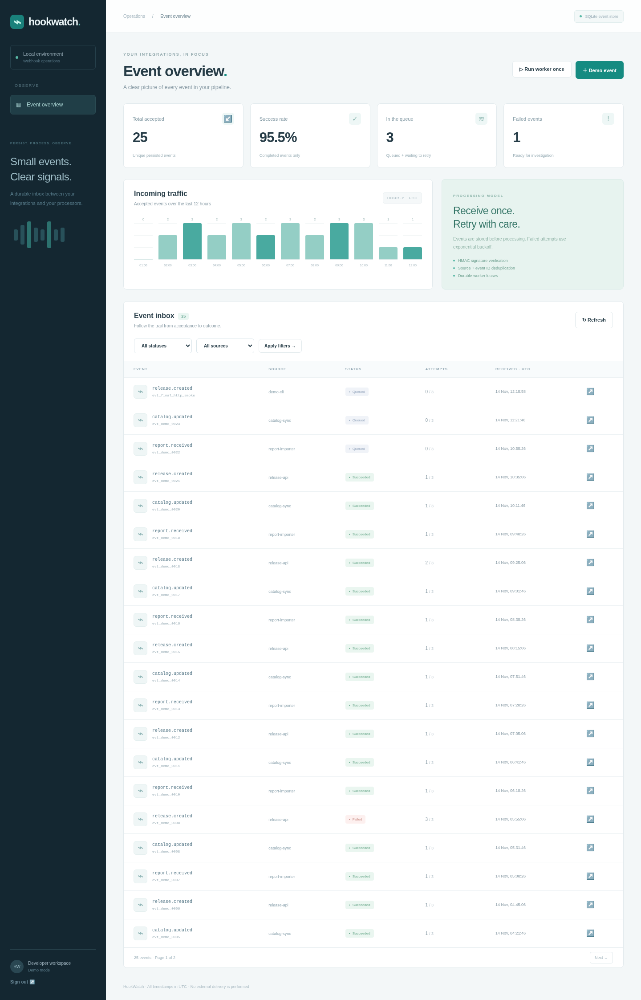

# HookWatch

[](https://github.com/KucukBoran/hookwatch/actions/workflows/ci.yml)

**A signed webhook inbox with durable processing and an observable retry trail.**

Python · Flask · SQLite · HMAC · Prometheus · Grafana

Integrations can send the same event more than once, processors can fail, and a
worker can stop halfway through a job. HookWatch makes those cases visible in a
small local application: accept an authenticated event, persist it, process it
under a lease, and retain the outcome of every completed attempt.

The processor validates fictional music operations data. It does not call
external services or deliver webhooks to arbitrary URLs.

## Preview

<details>
<summary>Open the event dashboard screenshot</summary>



</details>

*Captured from the running local application with fictional demo data.*

## Features

- HMAC-SHA256 signatures over the timestamp and exact request body.
- A five-minute timestamp window and a 64 KiB request limit.
- Source + event ID deduplication; conflicting reused IDs return HTTP 409.
- Durable queue with three attempts, exponential backoff and failed-event requeue.
- Worker leases and rejection of stale worker completions.
- Responsive event inbox with filters, pagination, payload inspection and history.
- Admin session login, CSRF protection and authenticated read APIs.
- Prometheus metrics with fixed, low-cardinality status/outcome labels.
- Optional Docker Compose monitoring stack with provisioned Grafana dashboard.
- Tests for signatures, concurrency, retries, crash recovery and access controls.

## Local setup

Requires **Python 3.12+**. Create a virtual environment from this repository root:

```sh
python -m venv .venv
```

Activate it with `source .venv/bin/activate` on macOS/Linux or
`.\.venv\Scripts\Activate.ps1` in PowerShell. If activation is blocked on Windows,
run `.\.venv\Scripts\python.exe` instead of `python` in the commands below.

```sh
python -m pip install -r requirements-dev.txt
cp .env.example .env
python -m hookwatch seed
python -m hookwatch serve
```

PowerShell also supports `Copy-Item .env.example .env` for the copy step.
Open **http://127.0.0.1:5000** and use the demo admin token
`demo-admin-token-change-me`. The `.env.example` secrets are public local-demo
values. Existing database records are preserved by the seed command.

In a second terminal, activate the same environment and start the worker:

```sh
python -m hookwatch worker
```

Or use **Run worker once** in the dashboard to observe each step manually.

## Send a real signed request to your local app

```sh
python scripts/send_event.py --id evt_walkthrough --failures 1
python scripts/send_event.py --id evt_walkthrough --failures 1
```

The first response is 201; the repeated event returns 200 with `duplicate: true`.
The example processor fails its first attempt, waits 10 seconds, then succeeds.
Failure simulation requires `DEMO_MODE=1`.

The seed contains a deliberately failed event. Requeueing it preserves history;
the payload still simulates three failures, so it fails again unless the processor
behavior changes. Retry is not a substitute for fixing a persistent error.

## Test

```sh
python -m pytest
```

Tests use temporary SQLite databases and a controlled clock. Backoff and lease
tests advance time explicitly instead of making the test suite sleep. The
concurrent duplicate test uses independent database connections.

## Optional Docker and monitoring

Copy `.env.example` to `.env` first, then use Docker Compose v2:

```sh
docker compose --profile monitoring up --build
```

In another terminal:

```sh
docker compose exec app python -m hookwatch seed
```

| Service    | Local address           | Access                     |
| ---------- | ----------------------- | -------------------------- |
| HookWatch  | `http://127.0.0.1:5000` | `ADMIN_TOKEN` from `.env`  |
| Prometheus | `http://127.0.0.1:9090` | Local interface            |
| Grafana    | `http://127.0.0.1:3000` | `demo` / `DemoGrafana123!` |

Grafana provisions a **HookWatch** folder and dashboard automatically.
Prometheus reads the admin token through a Compose secret sourced from
`ADMIN_TOKEN`. The app and worker share a named SQLite volume. Stop services with
`docker compose --profile monitoring down`; volumes remain intact.

For just the app and worker, omit `--profile monitoring`.
See [testing](docs/VERIFICATION.md) for validation coverage.

## Configuration

Environment variables take precedence over the root `.env` file.

| Variable         | Purpose                                                    |
| ---------------- | ---------------------------------------------------------- |
| `DATABASE_PATH`  | SQLite file; defaults to `instance/hookwatch.sqlite`       |
| `ADMIN_TOKEN`    | UI login and read API/metrics bearer token; 20+ characters |
| `WEBHOOK_SECRET` | Incoming request signing key; 20+ characters               |
| `SECRET_KEY`     | Flask session signing key; 20+ characters                  |
| `DEMO_MODE`      | `1` enables seeding, demo button and simulated failures    |
| `COOKIE_SECURE`  | `1` enables HTTPS-only cookies                             |
| `HOST`, `PORT`   | Local development server; defaults to `127.0.0.1:5000`     |

The app fails to start if required secrets are missing or too short. Gunicorn is
included for Linux/container execution; native Windows uses the Flask demo server.

## Project map

| Path                    | Responsibility                                     |
| ----------------------- | -------------------------------------------------- |
| `hookwatch/__init__.py` | App factory, HTTP routes, UI auth and metrics      |
| `hookwatch/service.py`  | Validation, deduplication, queue and lease rules   |
| `hookwatch/security.py` | Exact-byte signature construction and verification |
| `hookwatch/database.py` | SQLite connections and transactions                |
| `hookwatch/__main__.py` | Server, seed and worker commands                   |
| `hookwatch/templates/`  | Escaped server-rendered pages                      |
| `scripts/send_event.py` | Signed sample webhook client                       |
| `monitoring/`           | Prometheus and Grafana configuration               |

- [Architecture and guarantees](docs/ARCHITECTURE.md)
- [Webhook API and metrics](docs/API.md)
- [Testing](docs/VERIFICATION.md)

## Scope and tradeoffs

HookWatch uses a single-operator deployment model. One shared webhook secret
authenticates all sources; `source` is an idempotency namespace, not a separately
trusted identity. It provides durable acceptance and **at-least-once processing**,
not exactly-once external effects. The included processor has no external effects.

Leases last 30 seconds without renewal; long-running handlers need lease
extension and idempotent side effects. SQLite suits a small demo, not a
distributed worker fleet. Sessions use signed cookies; logout clears the browser
cookie, but global revocation requires key rotation or a server-side session store.
There is no retention job, per-source key rotation, multi-tenant access or API
ingestion rate limit. Do not expose the sample credentials publicly.

Future work: PostgreSQL queue claiming, per-source signing keys, a real
idempotent processor, retention controls and ingress throttling.

References: [Flask testing](https://flask.palletsprojects.com/en/stable/testing/),
[Python HMAC](https://docs.python.org/3/library/hmac.html),
[Prometheus configuration](https://prometheus.io/docs/prometheus/latest/configuration/configuration/),
[Grafana provisioning](https://grafana.com/docs/grafana/latest/administration/provisioning/).

MIT licensed. See [LICENSE](LICENSE).
