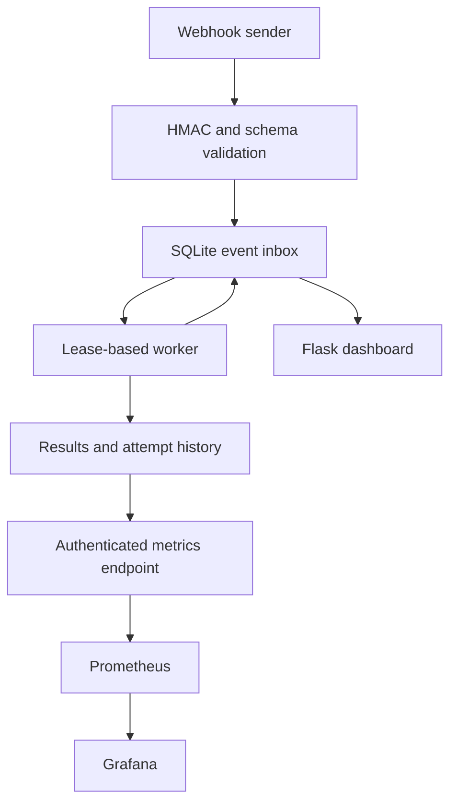
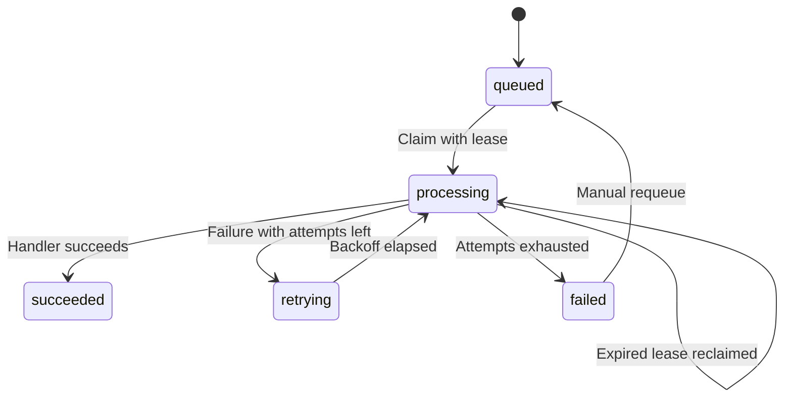

# Architecture and guarantees

## Components

The sender receives success after the event is committed, before the processor
runs. Persistence and processing are deliberately separate.

## Idempotency

`UNIQUE(source, external_id)` is the final database invariant. Within an immediate
transaction, ingestion compares the stored hash with a canonical JSON hash.
Equivalent JSON with different whitespace is a duplicate (200). Reusing the same
identity with changed content is a conflict (409). A new identity is accepted (201).

The signature still uses the **exact raw request bytes**, not canonical JSON.
Canonicalization is only used after signature verification for deduplication.

## Processing lifecycle

The worker commits its claim before running the handler. A claim increments the
attempt count and sets a 30-second lease with a random token. Completion requires
both the current token and an unexpired lease. A stale worker cannot overwrite a
newer worker's result. An expired final attempt moves to failed during the next
claim scan.

The default maximum is three attempts. Failure on attempt 1 waits 10 seconds;
failure on attempt 2 waits 20 seconds; attempt 3 becomes failed. Manual requeue
resets the cycle's attempt count but preserves prior attempts and actions.

## Crash boundaries

- Crash before acceptance commit: no accepted record; sender can retry.
- Crash after commit but before response: sender retries; deduplication returns
  the existing event.
- Crash after a worker claim: another worker can reclaim after the lease expires.
- Crash after an external side effect but before completion would allow repeated
  effects. The demo handler has no external effects; a real handler needs its own
  idempotency key or outbox design.
- An expired worker's abandoned attempt is recorded through an activity message,
  not a completed-attempt row. Attempt metrics count completed attempts only.

## Metrics

The event gauge reports current statuses. Completed-attempt counters are derived
from persistent history, so restarting the Python process does not reset them.
Manually removing the database does reset history. Labels are limited to five
statuses and two outcomes; source IDs, payloads and event IDs are not metric labels.

Success rate is `succeeded / (succeeded + failed)`, excluding nonterminal events.
An empty terminal set displays an em dash instead of a misleading 100%.

## Why SQLite?

SQLite keeps local setup independent of a database server. Transactions and
unique constraints enforce event identity and worker ownership. Scaling to a
larger worker fleet would require a queue backend such as PostgreSQL with row
locking and `SKIP LOCKED`, together with backpressure, retention and schema
migrations.
